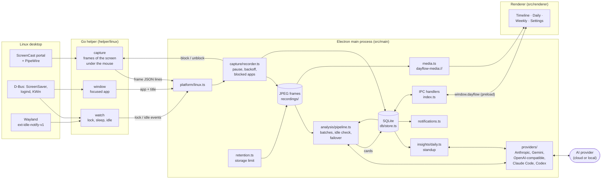
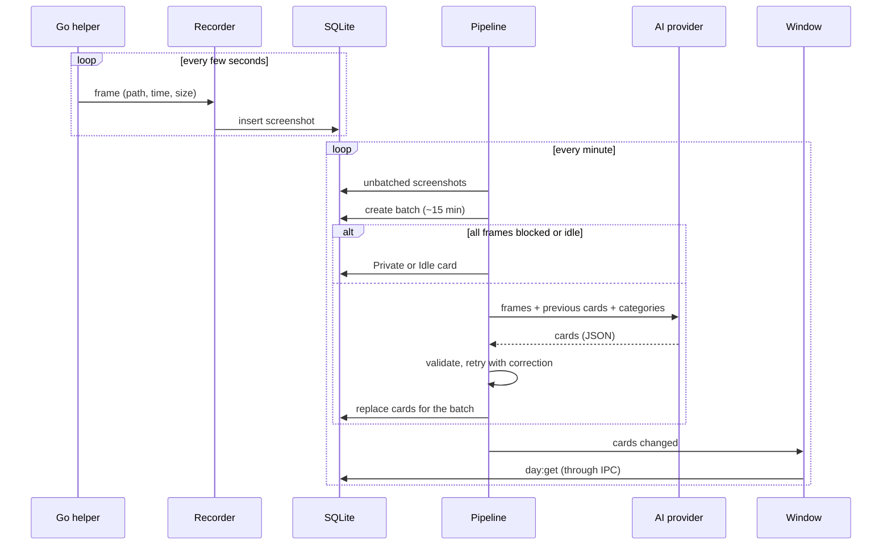

# Architecture

How dayflow-electron turns screenshots into a timeline. For what is built and
what is next, see [roadmap.md](roadmap.md). For Linux desktop details, see
[platform-notes.md](platform-notes.md).

## Overview

The app has three processes. Only the main process touches files, the
database and the network.

- **Renderer**: the React UI in a sandboxed window. It has no Node access. It
  calls the main process through the `window.dayflow` API that the preload
  script exposes, and it loads screenshots and icons through the
  `dayflow-media://` scheme.
- **Main process** (Node, Electron): records, stores, analyzes and serves the
  data.
- **Linux helper**: a Go program for what Electron cannot do on Wayland.
  The main process starts it and reads JSON lines from it.

## From frame to card

1. **Capture.** The helper shares all screens once through the ScreenCast
   portal and keeps the restore token, so later starts show no dialog. It
   reads frames from PipeWire and uses the cursor metadata to keep only the
   screen under the mouse. Every few seconds (10 s by default) it writes a
   JPEG and prints a `frame` line.
2. **Record.** The recorder stores each frame in `screenshots`. It pauses
   while the screen is locked or the computer sleeps, and when you pause it
   from the tray. While a blocked app (a password manager) has focus, the
   helper writes no file and the recorder stores a placeholder row instead.
3. **Batch.** Every minute the pipeline groups unbatched frames into
   `analysis_batches` like upstream: about 15 minutes each, split at gaps of
   more than 2 minutes, and at least 5 minutes long.
4. **Shortcuts.** A batch that is all blocked frames becomes a "Private" card.
   A batch where the idle check sees no activity becomes an Idle card. Neither
   needs a model call.
5. **Analyze.**
   - Cloud providers get one request with a sample of the frames, the
     previous cards and the categories (upstream's prompt, verbatim). The
     reply is checked; on errors the model gets up to 3 tries with a
     correction message.
   - Local models (and cloud models whose cards keep failing the checks) use
     the two-step path: describe each frame, turn the descriptions into
     observations, then write the summary and title and maybe merge with the
     previous card.
   - When the main provider fails, the fallback provider takes over.
     Failed batches get a "Processing failed" card and are retried later.
6. **Store and show.** Cards replace the batch's old cards in
   `timeline_cards`. The main process tells the window, which reloads the day.

## Insights

- **Daily** builds its activity grid from the day's cards in the renderer.
  The standup is written by the AI provider once a day after 4 AM, from the
  best of the last three days with enough activity (`insights/daily.ts`).
- **Weekly** needs no AI. Every chart is computed from the week's cards in
  `src/shared/weekly.ts`.
- **Unlocks** follow upstream: Daily after 5 hours of analyzed data, Chat
  after 10, Weekly after 30.

## Data

- **SQLite** (`dayflow.sqlite` in the data folder) keeps upstream's table
  names: `screenshots`, `analysis_batches`, `batch_screenshots`,
  `timeline_cards`, `observations`, `llm_calls`, `timeline_review_ratings`,
  `day_goals`, `day_goal_categories`, `daily_standup_entries`. Migrations are
  counted with `PRAGMA user_version`. Times are Unix seconds.
- **Days run from 4 AM to 4 AM**, so a late night stays on the day it began
  (`src/shared/day.ts`).
- **Frames** are JPEG files in `recordings/`. The retention job deletes the
  oldest ones when the storage limit is reached; cards stay.
- **Settings** are a JSON file. API keys are encrypted with Electron's
  `safeStorage` (KWallet or Secret Service on Linux).

## Code layout

| Path | What |
| --- | --- |
| `src/main/index.ts` | Starts everything and registers the IPC handlers |
| `src/main/capture/` | Recorder: pause, restart with backoff, blocked apps |
| `src/main/platform/` | OS interface; `linux.ts` runs the Go helper |
| `src/main/analysis/` | Batching, idle check, prompts, card checks, two-step path, pipeline |
| `src/main/providers/` | One adapter per provider; `cli/` runs Claude Code and Codex on the host |
| `src/main/insights/` | Daily standup generation |
| `src/main/db/` | Schema migrations and all SQL |
| `src/main/media.ts` | Serves frames and site icons to the window |
| `src/main/notifications.ts` | Desktop notifications |
| `src/preload/` | The `window.dayflow` API |
| `src/renderer/src/` | React views: Timeline, Daily, Weekly, Settings, Onboarding |
| `src/shared/` | Pure logic used by both sides: days, categories, Daily and Weekly math, export, failure kinds |
| `helper/linux/` | Go helper: `portal/`, `pipewire/`, `wayland/`, `frames/`, commands in `cmd/` |
| `flatpak/` | Flatpak manifest and desktop file |

Most logic sits in `src/shared/` and `src/main/analysis/` as pure functions,
so the tests run without Electron. Run them with `npm test`; run the Go tests
with `npm run test:helper`.
